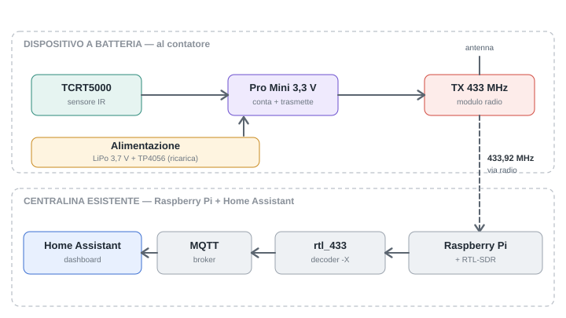

# Smart Water Meter — contatore acqua a batteria su 433 MHz

Digitalizza un contatore dell'acqua analogico (**Maddalena CD SD PLUS TCM 142/10**, Q3 2,5 m³/h) e porta il consumo in **Home Assistant**, senza corrente al contatore e riusando un ricevitore RTL-SDR già in funzione.

```
TCRT5000 (ottico IR) → Pro Mini 3.3V/8MHz → STX882 433,92 MHz OOK
      ))) radio )))
RTL-SDR → rtl_433 (Raspberry Pi) → MQTT → Home Assistant
```



## Stato

| Tratto | Stato |
|---|---|
| Sensore ottico + lettura differenziale (banco) | ✅ validato |
| Contrasto IR bianco / rosso / nero (carta) | ✅ validato |
| Rilevazione dinamica a velocità reale | ⏳ da fare (al contatore) |
| Radio Pro Mini → STX882 → RTL-SDR → rtl_433 | ✅ validato (in garage, vicino al Pi) |
| rtl_433 → MQTT → Home Assistant | ✅ verificato il 23/10/2026 |
| Firmware definitivo (conteggio, sleep, EEPROM, batteria) | ⏳ da scrivere |
| Sensore HA per il nuovo frame | ⏳ da scrivere (dopo frame definitivo) |
| Montaggio meccanico (supporto 3D) | ⏳ da progettare |

Dettaglio in [docs/roadmap.md](docs/roadmap.md).

## Struttura del repo

| Cartella | Contenuto |
|---|---|
| [`docs/`](docs/) | Architettura, decisioni, protocollo radio, test, roadmap |
| [`hardware/`](hardware/) | Distinta componenti, schemi elettrici, supporto 3D |
| [`firmware/`](firmware/) | Sketch Arduino (test validati + firmware definitivo) |
| [`raspberry/`](raspberry/) | Servizio rtl_433, decoder, procedure sul Pi |
| [`homeassistant/`](homeassistant/) | Configurazione HA (attuale e nuova) |

## Documentazione

- [Architettura](docs/architettura.md) — componenti, flusso dati, vincoli
- [Hardware](docs/hardware.md) — cablaggio, pin, regole di sicurezza
- [Protocollo radio](docs/protocollo-radio.md) — formato del frame OOK
- [Ricezione su Raspberry](docs/ricezione-raspberry.md) — rtl_433, servizio, diagnostica
- [Home Assistant](docs/home-assistant.md) — entità attuali e migrazione
- [Decisioni](docs/decisioni.md) — perché ottico, perché questo MCU, alternative scartate
- [Test e validazioni](docs/test-e-validazioni.md) — risultati misurati
- [Montaggio del sensore](docs/montaggio-sensore.md)
- [Roadmap](docs/roadmap.md)

## Avvio rapido

- **Caricare un firmware sul Pro Mini** → [firmware/README.md](firmware/README.md)
- **Verificare la ricezione sul Pi** → [docs/ricezione-raspberry.md](docs/ricezione-raspberry.md)

> Le credenziali MQTT non sono nel repo: vanno in `/etc/rtl433.env` sul Pi (vedi [`raspberry/rtl433.env.example`](raspberry/rtl433.env.example)).
